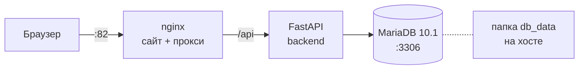

# Веб-отчётность — журнал аварий сети

Решение кейса **ООО «Екатеринбург 2000» (Мотив)** на **Всероссийском хакатоне связи** · команда **«Нейромантики»**

Дежурный ЦОУ регистрирует аварию на сети за минуту: длительность и простой БС считаются сами,
а отчёт за любой период выгружается в Excel одной кнопкой.


---

## Быстрый старт

Нужен только Docker с Docker Compose.

```bash
git clone https://github.com/lkopik/Motiv-Case.git
cd Motiv-Case
docker compose up -d --build
```

Откройте **http://localhost:82** и войдите под одной из учёток:

| Роль | Логин | Пароль | Что может |
| :--- | :--- | :--- | :--- |
| Администратор | `admin` | `admin123` | всё: аварии, удаление, списки |
| Дежурный | `duty` | `duty123` | вносит и правит аварии |
| Инженер | `engineer` | `engineer123` | только просмотр и выгрузка CSV |

Документация API (Swagger): **http://localhost:82/docs**

> Если сборка падает с `additional privileges requested`, запустите `COMPOSE_BAKE=false docker compose up -d --build`.

---

## Как пользоваться

| Задача | Где | Что нажать |
| :--- | :--- | :--- |
| Записать аварию | **Аварии** | заполнить форму → «Записать аварию» (или Ctrl+Enter) |
| Закрыть аварию | **Аварии**, список справа | «Закрыть сейчас» |
| Найти аварию за период | **Архив** | кнопка периода или даты, фильтры, поиск |
| Открыть аварию на весь экран | **Архив** | «Просмотр» в строке |
| Выгрузить отчёт в Excel | **Архив** | «Выгрузить CSV» |
| Посмотреть, где аварии | **Карта** | точки на карте, поиск города, клик по ТЦ |
| Добавить новый ТЦ или тип | **Списки** (админ) | «Добавить» |
| Инструкция для сотрудников | **Справка** | на сайте, можно распечатать |

## Что умеет

**Аварии.** Форма из 19 полей ТЗ.
- Направление, ТЦ, категория, тип сети и тип аварии выбираются из списков; у каждого поля подсказка «?».
- Начало и окончание — из календаря; галочка **НВ** (настоящее время) для незакрытых аварий.
- **Длительность аварии** и **общий простой БС** считаются сразу при вводе.
- **Подсказки дежурному**: после 2 букв предлагаются адреса, оборудование и «кому» из прошлых аварий;
  выбрал адрес — ТЦ, направление, сеть и оборудование подставятся сами.
- Кнопки «Сейчас», «Как прошлая», ввод времени числом минут (`40` → `00:40:00`).
- Справа — незакрытые аварии с идущим таймером; список обновляется сам, если аварию внёс другой дежурный.

**Архив.** Все аварии за период, фильтры, поиск, сортировка по любому столбцу, прокрутка сверху и снизу,
просмотр на весь экран, итог по общему простою, **выгрузка в CSV** для Excel.

**Статистика.** Аварии по дням, по техцентрам, типам и направлениям, суммарный простой и средняя длительность.

**Карта.** Настоящая карта (Leaflet + OpenStreetMap), библиотека лежит в проекте и не грузится из интернета. Аварии точками у своих БС: красные — не закрыты, 1-я категория; оранжевые — не закрыты; серые — закрыты. Поиск по городу или коду БС, клик по ТЦ, во всплывающем окне — аварии на БС со ссылкой «открыть». Если интернета нет и подложка не грузится, точки, города и техцентры остаются — карта не «отваливается», как Яндекс.

**Списки.** Администратор сам добавляет и убирает ТЦ, направления, типы. Старые аварии сохраняют свои значения.

**Справка.** Инструкция для дежурных прямо на сайте: по шагам, все поля, формулы, что делать при ошибках.

**Надёжность.** Нет связи с базой — на экране понятная плашка «Нет связи с базой данных» с инструкцией,
внизу всегда видно состояние связи. Данные хранятся в папке `db_data` и не теряются при падении контейнера.

Подробный отчёт о реализации с блок-схемами и кодом: [docs/Отчёт о реализации.md](docs/Отчёт%20о%20реализации.md).

---

## Соответствие ТЗ

| Требование | Как сделано |
| :--- | :--- |
| 3.1 Запуск в Docker | `docker compose up` — три контейнера: база, бэкенд, сайт |
| 3.3 MariaDB 10.1 на порту 3306 | образ `mariadb:10.1`, порт `3306` |
| 3.4 Linux, Debian-подобный | все образы на Debian/Ubuntu |
| 3.5 Chrome 75 | чистые HTML/CSS/JS без сборки и нового синтаксиса, без внешних шрифтов (в ЦОУ нет интернета) |
| 3.6 Роли с разными правами | администратор, дежурный, инженер; права проверяет сервер |
| Вкладка «Аварии», 19 полей | все поля, списки, календари, НВ |
| Автоподсчёт полей 15 и 17 | длительность = окончание (или текущее время при НВ) − начало; общий простой = перерыв × количество БС |
| Вкладка «Отчётность» | период, правка каждой строки, выгрузка CSV |
| Таблица БД | поля строго по ТЗ (включая `LENGHT`), плюс `ID` и «кто внёс / кто изменил» |

Принятые решения:
- **НВ** хранится в `END_TIME` как `0000-00-00 00:00:00`, как требует ТЗ.
- **«С» (сектор)** в `NUMB_RBS` хранится как `0`; в общем простое сектор считается за одну БС.
- `COMMON_PROSTOY` ограничен `838:59:59` — это предел типа `TIME` в MariaDB.

---

## Как устроено



- **frontend/** — страницы сайта (`index` аварии, `reports` архив, `stats`, `map` карта, `dicts` списки, `help` справка); общая логика в `app.js`, форма аварии в `form.js`.
- **backend/main.py** — FastAPI: вход, роли, все адреса `/api`.
- **backend/backend.py** — работа с базой.
- **init_scripts/init.sql** — таблицы, справочники, пользователи и демо-аварии за 3 недели.
- **deploy/autoupdate.sh** — стенд: раз в 5 минут подтягивает свежий код с GitHub и пересобирается.

**Данные не теряются.** База лежит в папке `db_data/` на хосте и переживает падение контейнера,
пересборку и перезагрузку. Начать с чистой базы:

```bash
docker compose down && sudo rm -rf db_data && docker compose up -d
```

**Масштабирование.** Бэкенд не хранит сессии в памяти (токен подписан), поэтому можно запустить несколько копий —
nginx сам распределит запросы:

```bash
docker compose up -d --scale backend=3
```

---

## Команда «Нейромантики»

| Роль | Участник | GitHub |
| :--- | :--- | :--- |
| Team Lead / DevOps | Леонид Копотилов | [@lkopik](https://github.com/lkopik) |
| Backend Developer | Егор Рожков | [@EpanijGentleman](https://github.com/EpanijGentleman) |
| Backend Developer | Артур Миннуллин | [@trollproblemsss](https://github.com/trollproblemsss) |
| Frontend Developer | Никита Игошев | [@fedorp554473-netizen](https://github.com/fedorp554473-netizen) |
| Business Analyst | Евгений Гуськов | [@boevoy-buryat](https://github.com/boevoy-buryat) |
| Team Coordinator | Владимир Пупышев | [@ValiantPerson](https://github.com/ValiantPerson) |
