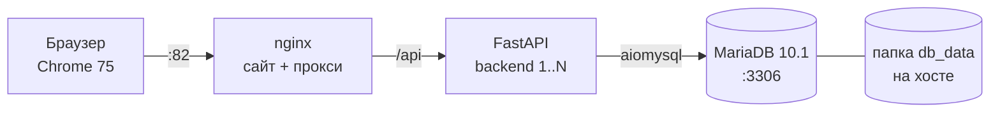

<div align="center">


# Журнал аварий ЦОУ

**Веб-отчётность по состоянию базовых станций сотовой сети**

Кейс №02 **ООО «Екатеринбург 2000» (Мотив)** · Всероссийский хакатон связи · команда **«Нейромантики»**


*Дежурный вносит аварию за минуту — длительность и простой считаются сами, отчёт за любой период выгружается в Excel одной кнопкой, а данные не теряются, даже если упал сервер.*

**[Демо-стенд: kukusik72.ru:82](http://kukusik72.ru:82)**

</div>

## Простыми словами


Сейчас аварии ведут в Excel-сводке: 19 полей руками, простой считают в уме, отчёт за период собирают часами. Мы заменили это одним сайтом с тремя ролями: **дежурный** записывает, **инженер** смотрит, **администратор** управляет.

---

## Содержание

- [Простыми словами](#простыми-словами)
- [Запуск за 1 минуту](#запуск-за-1-минуту)
- [Учётные записи](#учётные-записи)
- [Что умеет](#что-умеет)
- [Как пользоваться](#как-пользоваться)
- [Соответствие ТЗ](#соответствие-тз)
- [Сверх ТЗ](#сверх-тз)
- [Как устроено](#как-устроено)
- [API](#api)
- [Надёжность и безопасность](#надёжность-и-безопасность)
- [Структура проекта](#структура-проекта)
- [Команда](#команда)

---

## Запуск за 1 минуту

Нужен только **Docker** с Docker Compose.

```bash
git clone https://github.com/lkopik/Motiv-Case.git
cd Motiv-Case
docker compose up -d --build
```

| Что | Адрес |
| :--- | :--- |
| Сайт | **http://localhost:82** |
| Документация API (Swagger) | http://localhost:82/docs |
| База данных MariaDB | `localhost:3306`, пользователь `root` |

> При первом запуске база заполняется автоматически: таблицы, справочники, пользователи и **231 реальная обезличенная авария** из сводки заказчика.
>
> Если сборка падает с `additional privileges requested` — запустите `COMPOSE_BAKE=false docker compose up -d --build`.

---

## Учётные записи

| Роль | Логин | Пароль | Права |
| :--- | :--- | :--- | :--- |
| Администратор | `admin` | `admin123` | всё: аварии, удаление, списки |
| Дежурный | `duty` | `duty123` | вносит и правит аварии |
| Инженер | `engineer` | `engineer123` | только просмотр и выгрузка CSV |

На странице входа достаточно нажать на строку с учёткой — логин и пароль подставятся сами.

---

## Что умеет

| Вкладка | Для чего |
| :--- | :--- |
| **Аварии** | Форма из 19 полей ТЗ + список незакрытых аварий с идущими таймерами |
| **Архив** | Все аварии за период: фильтры, поиск, сортировка, правка строки, выгрузка CSV; горизонтальная прокрутка закреплена сверху |
| **Статистика** | Аварии по дням, техцентрам, типам и направлениям, суммарный простой |
| **Карта** | Аварии точками у своих БС по 19 техцентрам, цвет по критичности, поиск города и кода БС |
| **Списки** | Значения выпадающих списков — администратор меняет без программиста |
| **Справка** | Инструкция для сотрудников прямо на сайте, можно распечатать |

### Автоматические расчёты

| Поле | Формула |
| :--- | :--- |
| **15. Длительность аварии** | окончание − начало; при **НВ** — текущее время − начало (растёт на глазах) |
| **17. Общее время простоя БС** | время перерыва связи × количество БС (сектор «С» = 1 БС) |

Оба поля считает **сервер** в SQL — клиент не может прислать неверное значение.

---

## Как пользоваться

| Задача | Где | Что нажать |
| :--- | :--- | :--- |
| Записать аварию | **Аварии** | заполнить форму → «Записать аварию» или `Ctrl+Enter` |
| Закрыть аварию | **Аварии**, список справа | «Закрыть сейчас» |
| Найти аварии за период | **Архив** | «Сегодня» / «7 дней» / «Месяц» или даты, фильтры, поиск |
| Открыть аварию на весь экран | **Архив** | «Просмотр» в строке |
| Выгрузить отчёт в Excel | **Архив** | «Выгрузить CSV» |
| Посмотреть, где аварии | **Карта** | точки на карте, поиск города, клик по ТЦ |
| Добавить новый ТЦ или тип | **Списки** (админ) | «Добавить» |
| Увеличить шрифт | шапка | `A+` (до 140%) |
| Ночная смена | шапка | «Тёмная тема» |

---

## Соответствие ТЗ

| Требование | | Как реализовано |
| :--- | :---: | :--- |
| 3.1 Запуск через Docker | ✅ | `docker compose up`, три контейнера: `db`, `backend`, `frontend` |
| 3.3 MariaDB 10.1, порт 3306 | ✅ | образ `mariadb:10.1`, `3306:3306` |
| 3.4 Linux, Debian-подобный | ✅ | `python:3.12-slim`, `nginx:stable` (Debian), `mariadb:10.1` (Ubuntu) |
| 3.5 Chrome 75 | ✅ | JS без нового синтаксиса и CDN, проверено парсером; свои галочки и фокус в CSS |
| 3.6 Роли администратор / дежурный / инженер | ✅ | `admin` / `duty` / `engineer`, права проверяет сервер |
| Вкладка «Аварии», 19 полей | ✅ | все поля, нумерация как в сводке заказчика |
| 5 выпадающих списков | ✅ | Направление, ТЦ, Категория, Тип сети, Тип — из таблицы `DICTS` |
| Начало / окончание из календаря | ✅ | `datetime-local` + кнопка «Сейчас» |
| «НВ» — дата с нулями в СУБД | ✅ | `END_TIME = '0000-00-00 00:00:00'` |
| Автоподсчёт полей 15 и 17 | ✅ | SQL на сервере, живой пересчёт для НВ |
| «Отчётность»: события за период | ✅ | вкладка «Архив» |
| Редактирование каждой строки | ✅ | окно аварии, `PUT /api/alarms/{id}` |
| Выгрузка CSV за период | ✅ | `;`, UTF-8 с BOM — открывается в Excel |
| Структура таблицы БД | ✅ | все 19 полей с типами из ТЗ, включая `LENGHT` |

---

## Сверх ТЗ

**Для дежурного**
- **Автозаполнение по объекту** — выбрал адрес БС, и ТЦ, направление, сеть, оборудование, количество БС и «кому» подставились из прошлой аварии.
- **Подсказки после 2 букв** по адресам, оборудованию, описаниям.
- **«Закрыть сейчас»** и **«Как прошлая»** — закрытие и серийные аварии в один клик.
- **Минуты вместо формата** — `40` → `00:40:00`.
- **Подсказка «?»** у каждого поля, `Ctrl+Enter` — сохранить, `Esc` — закрыть окно.
- Список незакрытых аварий **обновляется сам** — видно аварии коллег.

**Для руководства и инженеров**
- **Карта аварий** на Leaflet + OpenStreetMap, библиотека лежит в проекте. Без интернета подложка пропадает, но точки, города и ТЦ остаются.
  Координат вышек в сводке нет, поэтому техцентры стоят на реальных местах городов, а каждая БС — рядом со своим ТЦ (5–20 км); угол и расстояние вычисляются из названия БС, так что точка всегда одна и та же. С реестром БС точки встанут на настоящие координаты без переделки карты.
- **Статистика** по дням, ТЦ, типам и направлениям.
- **Журнал изменений** — кто внёс и кто последним изменил каждую запись.

**Для всех**
- **Тёмная тема** и **масштаб 90–140%** — для ночной смены и удобства всех сотрудников.
- **Понятные ошибки** — при обрыве связи с базой красная плашка с инструкцией вместо «Internal Server Error».

---

## Как устроено



| Слой | Технологии |
| :--- | :--- |
| Фронтенд | HTML, CSS, JavaScript без сборки; Leaflet 1.9.4 (локально) |
| Бэкенд | Python 3.12, FastAPI, Pydantic, aiomysql, uvicorn |
| База | MariaDB 10.1, utf8mb4, часовой пояс +05:00 |
| Инфраструктура | Docker Compose, nginx, скрипт автообновления стенда |

### База данных

- **`ALARMS`** — журнал аварий: 19 полей строго по ТЗ + `ID`, `CREATED_BY/AT`, `UPDATED_BY/AT`, индекс по `BEGIN_TIME`.
- **`DICTS`** — значения выпадающих списков (меняет администратор).
- **`USERS`** — пользователи, роли, SHA-256 паролей.

Принятые решения: **НВ** — нулевая дата в `END_TIME`; **«С» (сектор)** — `0` в `NUMB_RBS`; общий простой ограничен `838:59:59` (предел типа `TIME`).

### Масштабирование

Бэкенд не хранит сессии в памяти (токен подписан), поэтому можно запустить несколько копий — nginx сам распределит запросы:

```bash
docker compose up -d --scale backend=3
```

---

## API

| Метод | Путь | Кто | Что делает |
| :--- | :--- | :--- | :--- |
| `POST` | `/api/login` | все | вход, выдача токена |
| `GET` | `/api/health` | все | состояние API и БД |
| `GET` | `/api/alarms` | все роли | аварии за период, фильтры, поиск |
| `GET` | `/api/alarms/{id}` | все роли | одна авария |
| `POST` | `/api/alarms` | admin, duty | создать |
| `PUT` | `/api/alarms/{id}` | admin, duty | изменить |
| `POST` | `/api/alarms/{id}/close` | admin, duty | закрыть «сейчас» |
| `DELETE` | `/api/alarms/{id}` | admin | удалить |
| `GET` | `/api/alarms-export.csv` | все роли | выгрузка CSV |
| `GET` | `/api/suggest`, `/api/autofill` | все роли | подсказки и автозаполнение |
| `GET` | `/api/stats` | все роли | статистика |
| `GET/POST/DELETE` | `/api/dicts…` | чтение — все, изменение — admin | справочники |

Интерактивная документация — **http://localhost:82/docs**.

---

## Надёжность и безопасность

**Данные не теряются.** База лежит в папке `db_data` на хосте. Проверено: `docker kill`, `docker compose down` и даже `down -v` — все записи на месте.

```bash
docker compose down && sudo rm -rf db_data && docker compose up -d   # начать с чистой базы
```

**Безопасность**
- пароли — только SHA-256-хеш;
- токен подписан HMAC-SHA256, срок 12 часов;
- права проверяются на сервере — запрос в обход сайта получит `403`;
- все SQL-запросы параметризованы — защита от инъекций;
- данные на странице экранируются — защита от XSS.

**Проверка данных** — в форме и на сервере: обязательны ТЦ, сетевой элемент и начало; даты не из будущего; количество БС 1–10000 или «С»; значения только из справочников, формат `чч:мм:сс`, окончание не раньше начала, лимиты длины полей (PW — 12, сетевой элемент и оборудование — 50, описание и «кому» — 300, подробное описание — 400).

---

## Структура проекта

```
Motiv-Case/
├── backend/
│   ├── main.py            # FastAPI: вход, роли, все /api, CSV, проверка данных
│   ├── backend.py         # работа с БД, расчёт полей 15 и 17
│   ├── requirements.txt
│   └── Dockerfile
├── frontend/
│   ├── index.html         # Аварии
│   ├── reports.html       # Архив
│   ├── stats.html         # Статистика
│   ├── map.html           # Карта
│   ├── dicts.html         # Списки
│   ├── help.html          # Справка
│   ├── login.html
│   ├── app.js  form.js  style.css
│   └── vendor/leaflet/    # карта, без CDN
├── init_scripts/init.sql  # таблицы, справочники, 231 авария
├── nginx/default.conf
├── deploy/autoupdate.sh   # автообновление стенда из GitHub
├── docs/                  # отчёт (MD, DOCX) и презентации
├── db_data/               # файлы базы на хосте, создаётся сама, в git не попадает
└── docker-compose.yml
```

| Документ | Что внутри |
| :--- | :--- |
| [Отчёт о реализации.md](docs/Отчёт%20о%20реализации.md) | архитектура, блок-схемы, фрагменты кода |
| [Отчёт_Мотив_Нейромантики.docx](docs/Отчёт_Мотив_Нейромантики.docx) | полный отчёт для жюри |
| [Презентация_6_слайдов.pptx](docs/Презентация_6_слайдов.pptx) | защита на 5 минут, по критериям оценки, текст в заметках |

---

## Команда

| Роль | Участник | GitHub |
| :--- | :--- | :--- |
| Team Lead / DevOps | Леонид Копотилов | [@lkopik](https://github.com/lkopik) |
| Backend Developer | Егор Рожков | [@EpanijGentleman](https://github.com/EpanijGentleman) |
| Backend Developer | Артур Миннуллин | [@trollproblemsss](https://github.com/trollproblemsss) |
| Frontend Developer | Никита Игошев | [@fedorp554473-netizen](https://github.com/fedorp554473-netizen) |
| Business Analyst | Евгений Гуськов | [@boevoy-buryat](https://github.com/boevoy-buryat) |
| Team Coordinator | Владимир Пупышев | [@ValiantPerson](https://github.com/ValiantPerson) |

<div align="center">

**«Другие сделали форму по ТЗ. Мы сделали рабочее место дежурного.»**

</div>
