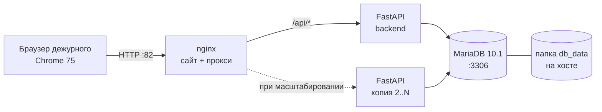
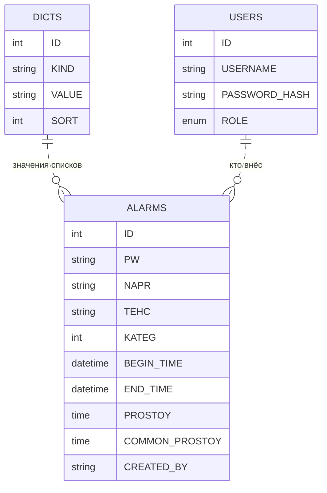
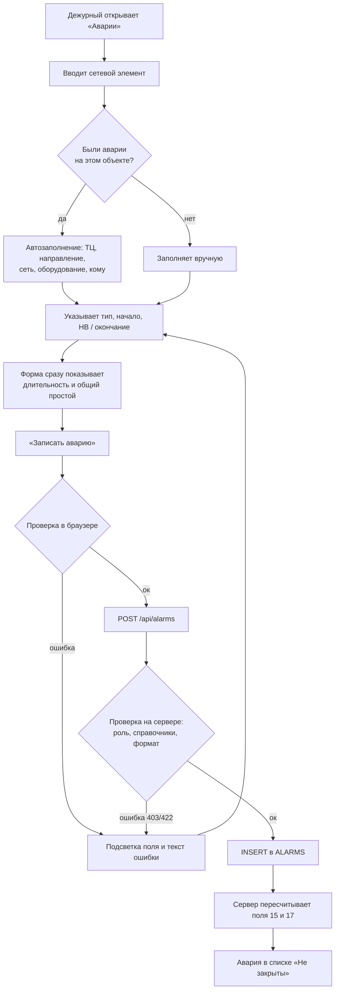
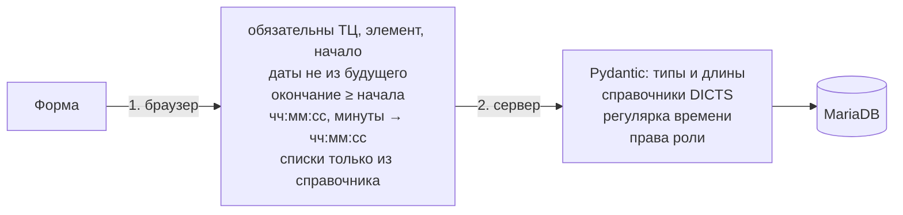
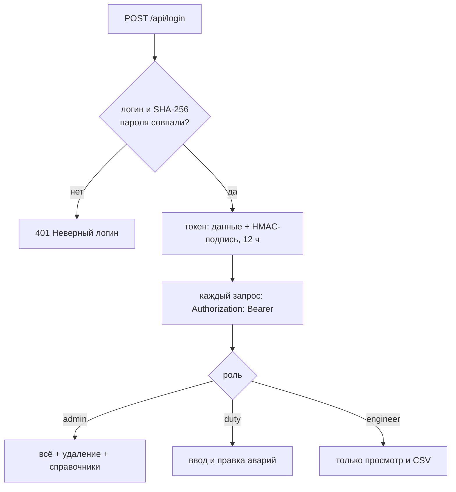

# Отчёт о реализации: «Веб-отчётность» — журнал аварий сети

Кейс ООО «Екатеринбург 2000» (Мотив) · Всероссийский хакатон связи · команда «Нейромантики»

## 1. Задача

Дежурные ЦОУ ведут учёт аварий на базовых станциях вручную (Excel-сводка). Нужно веб-приложение, в котором
дежурный быстро вносит аварию, длительность и простой считаются автоматически, а отчётность за любой период
выгружается в CSV. Требования ТЗ: Docker, MariaDB 10.1 на порту 3306, Linux (Debian), Chrome 75, роли
«администратор», «дежурный», «инженер».

## 2. Архитектура



| Контейнер | Образ | Назначение |
| :--- | :--- | :--- |
| `db` | `mariadb:10.1` | база данных, данные в папке `db_data` на хосте |
| `backend` | `python:3.12-slim` | FastAPI: вход, роли, аварии, расчёты, CSV |
| `frontend` | `nginx:stable` | раздаёт сайт и проксирует `/api` на бэкенд |

Три отдельных контейнера — по рекомендации эксперта. Бэкенд не хранит сессии в памяти, поэтому его можно
запустить в нескольких копиях: `docker compose up -d --scale backend=3`.

## 3. База данных

Таблица `ALARMS` — строго по ТЗ (19 полей, включая `LENGHT`), плюс `ID` для правки строк и поля
`CREATED_BY / UPDATED_BY` для прозрачности отчётности (п. 4.1 ТЗ). Дополнительно:
`DICTS` — справочники выпадающих списков, `USERS` — пользователи и роли.



Решения по неоднозначным местам ТЗ:
- **НВ** (настоящее время) хранится в `END_TIME` как `0000-00-00 00:00:00`, как требует ТЗ.
- **«С» (сектор)** в `NUMB_RBS` (тип INT) хранится как `0`, в расчётах считается за одну БС.
- Демо-данные — 231 реальная обезличенная авария из сводки «Аварии на сети СС».

## 4. Регистрация аварии — блок-схема



## 5. Автоматические расчёты (поля 15 и 17)

Расчёт выполняется на сервере в SQL — клиент не может прислать «свои» значения:

```python
# backend/backend.py
RECALC = f"""UPDATE ALARMS SET
    LENGHT = TIME_FORMAT(SEC_TO_TIME(LEAST(TIMESTAMPDIFF(SECOND, BEGIN_TIME,
             IF(END_TIME = '{NV}', NOW(), END_TIME)), {TIME_MAX})), '%%H:%%i:%%s'),
    COMMON_PROSTOY = SEC_TO_TIME(LEAST(TIME_TO_SEC(PROSTOY) * GREATEST(NUMB_RBS, 1), {TIME_MAX}))
    WHERE ID = %s"""
```

- **Длительность** = окончание − начало; при «НВ» — текущее время − начало. Для открытых аварий
  длительность пересчитывается при каждом запросе, на сайте таймер идёт каждую секунду.
- **Общий простой** = время перерыва связи × количество БС (сектор = 1).
- Значения ограничены `838:59:59` — пределом типа `TIME` в MariaDB.

## 6. Проверка данных



```python
# backend/main.py — серверная проверка аварии
async def check_alarm(alarm: DataUpload):
    data = alarm.model_dump(by_alias=True)
    lists = await db.get_dicts()
    for col, kind, name in [("NAPR", "napr", "Направление"), ("TEHC", "tehc", "ТЦ"), ...]:
        if data[col] and data[col] not in lists[kind]:
            raise HTTPException(422, f"«{data[col]}» нет в списке «{name}»")
    ...
    if data["END_TIME"] and data["END_TIME"] < data["BEGIN_TIME"]:
        raise HTTPException(422, "Окончание раньше начала")
```

Все SQL-запросы параметризованы (`%s`) — защита от SQL-инъекций.

## 7. Роли и вход



```python
def can_edit(user=Depends(get_user)):  # админ и дежурный
    if user["role"] not in ("admin", "duty"):
        raise HTTPException(403, "Недостаточно прав")
    return user
```

Права проверяются на сервере: даже запрос в обход сайта получит 403.

## 8. Надёжность

- База хранится в папке `db_data` на хосте — переживает падение и пересоздание контейнера.
- Если база недоступна, сервер отвечает понятным сообщением (код 503), а сайт показывает плашку
  «Нет связи с базой данных» с инструкцией; внизу экрана всегда видно состояние связи.
- Стенд обновляется сам: `deploy/autoupdate.sh` раз в 5 минут забирает свежий код с GitHub и пересобирает
  контейнеры, не трогая данные.

## 9. Интерфейс

- Вкладки: **Аварии**, **Архив**, **Статистика**, **Карта** (Leaflet + OpenStreetMap; без интернета пропадает только подложка, точки БС стоят у своих техцентров — в сводке нет координат), **Списки** (админ), **Справка**.
- Подсказки к каждому полю («?»), автозаполнение по прошлым авариям, кнопки «Сейчас», «Как прошлая»,
  «Закрыть сейчас», просмотр аварии на весь экран, сортировка таблицы, выгрузка CSV для Excel.
- Масштаб интерфейса A− / A+ (90–140%) и тёмная тема для ночной смены, выбор запоминается.
- Ограничения длины полей: PW — 12, сетевой элемент и оборудование — 50, описание и «кому» — 300, подробное описание — 400 символов (в форме и на сервере).
- Крупный шрифт и элементы, нет внешних библиотек и шрифтов (в ЦОУ нет интернета), совместимость с Chrome 75.

## 10. Соответствие ТЗ

| Пункт | Выполнено |
| :--- | :--- |
| 3.1 Docker | ✓ |
| 3.3 MariaDB 10.1, порт 3306 | ✓ |
| 3.4 Linux Debian-подобный | ✓ |
| 3.5 Chrome 75 | ✓ |
| 3.6 Роли администратор / дежурный / инженер | ✓ |
| Вкладка «Аварии», 19 полей, списки, календари, НВ | ✓ |
| Автоподсчёт длительности и общего простоя | ✓ |
| Вкладка «Отчётность»: период, правка строк, CSV | ✓ |
| Структура таблицы БД по ТЗ | ✓ |

## 11. Развитие

Реестр БС и топология сети, приём аварий из OSS, группировка массовых аварий в одну «корневую»,
прогноз отключения по ёмкости АКБ, эскалации по SLA, автосводка смены, импорт/экспорт Excel-сводки,
мобильное приложение для выездных инженеров.
